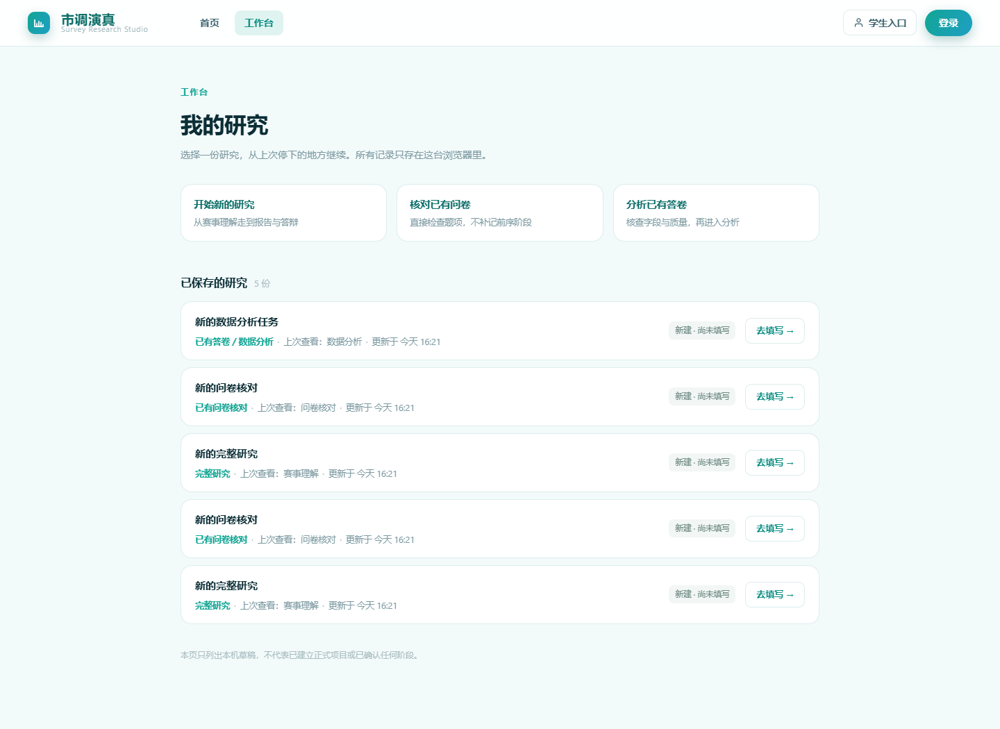
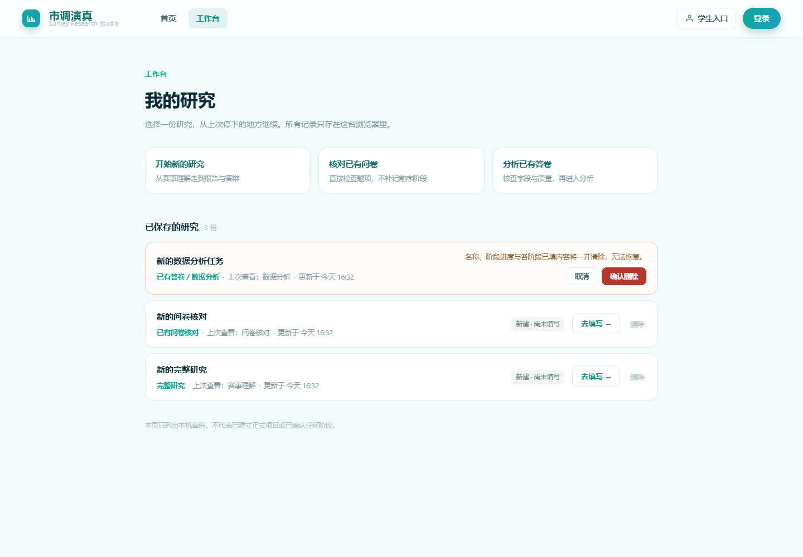

# 工作台列表页 · 交付与验证记录

> 范围：新增 `/workbench`（我的研究：挑一份继续 / 新建 / 删除）；顶栏导航第二项由
> 「研究工作台」（直跳单个任务编辑器）改为「工作台」（列表页）；
> 并把 `/research/work` 的返回链接改指列表页，形成「首页 → 列表 → 单个研究 → 回列表」闭环。
> 状态：已交付。真实浏览器（Edge CDP）逐项验过，`vue-tsc -b` 0 错、`pnpm build` 通过、断链 0。
> 不含：优秀作品页（用户明确不做）、研究成果页、调查计划页（详见 §一 的取舍）。
> 关联文档：`docs/f-workbench-design.md`（工作台**对话组件组**的设计，与本文的**列表页**是两件事）。

---

## 一、为什么要加这一页

原型《拒绝脑补》顶栏是 5 项（首页 / 工作台 / 优秀作品 / 研究成果 / 调查计划）+ 设置图标。
逐项翻过它对应的页面内容后，只有一项能落到本项目：

| 原型项 | 原型页面上真正做的事 | 本项目落脚点 | 结论 |
|---|---|---|---|
| 首页 | 封面、输入区、三种起点、最近项目 | 已有 `/`（`ResearchHomeView.vue`） | 保留 |
| 工作台 | 「选择一份研究，从上次停下的地方继续」，列出全部项目 | `store.registry.tasks` 已有 `title` / `updatedAt` / `workflowKind` / `viewedPhase` | **做** |
| 优秀作品 | 按主题分类计数、年份与奖项筛选、网格 + 「待收录」占位 | 首页 `HomeCaseGrid` 的 12 条 | **不做**（用户决定） |
| 研究成果 | 按项目铺开已保存成果 | 成果散在 `scdc-f-topic-plan-v1:<taskId>` 各阶段，无独立结构 | **不做独立页** |
| 调查计划 | AI 出任务清单、团队到现场执行、登记进度 | 无成员体系 / 分派 / 排期数据 | **不做** |

真正的缺口是这一条：**用户一旦离开 `/research/work`，就找不到自己做过什么**。
编辑器顶部那个下拉框被 `workflowKind` 过滤过——选了「完整研究」就看不到数据分析类任务。

「优秀作品」被否掉的原因值得记一笔：12 条撑不起「作品库」这种词，页面得永远挂一句
「当前收录 12 份」，否则用户会以为内容不全或坏了。不如不做。

---

## 二、页面结构

三个区块，自上而下：

1. **三种起点卡** —— 开始新的研究 / 核对已有问卷 / 分析已有答卷。
   点击时**显式**调 `store.create(kind)` 再跳 `?mode=...&task=...`。
2. **已保存的研究** —— 按 `updatedAt` 倒序，每条：标题、类型、上次查看的阶段、更新时间、
   保存状态胶囊、「去填写 / 继续」按钮、删除入口。
3. **底部说明** —— 「本页只列出本机草稿，不代表已建立正式项目或已确认任何阶段」。

数据全部来自 `store.registry.tasks`，**没有新增任何字段、没有直接读写 localStorage**。



---

## 三、四个刻意的决定

### 1）不画进度条

`viewedPhase` 只表示「上次在看哪一步」，项目本身**没有「已完成」字段**——阶段确认走服务端，
接口尚未接入。渲染成「60%」就是编造。所以只写「上次查看：选题分析」。

### 2）新建任务必须显式 `store.create(kind)`

只跳 `?mode=x` 是不行的：编辑器的 watch 调的是 `store.open(kind)`，而 `open` 会优先打开
`lastByKind[kind]`，结果是把上一份研究又打开一遍。工作台内部那个「新建任务」按钮也是这么做的。

### 3）状态三档说真话

| 条件 | 文案 | 语气 |
|---|---|---|
| `revision === 0` | 新建 · 尚未填写 | neutral |
| 有 `savedAt` | 已保存到本机 | ok |
| 其余 | 本机编辑未保存 | warn |

### 4）窄屏不用裸分隔点

元信息用 `span + span::before { content:'·' }` 让点**跟随后一项**。
直接写 `<span>·</span>` 会在换行时行尾吊一个孤点；≤640px 干脆 `content:none` + `gap:10px`，
否则换行后行首带点。两种都试过并截图确认。


---

## 四、删除：一份研究散在三个键

用户点几次「开始新的研究」就会堆一串同名记录，必须能删。

### 三个键必须一起清

| 键 | 内容 |
|---|---|
| `shidiaoyanzhen.research-tasks.v1` | 任务目录（含任务本身、`lastByKind` 指针） |
| `scdc-f-topic-plan-v1:<taskId>` | 第 2 / 3 / 4 / 6 阶段草稿 |
| `research-sandbox-ref:task:<taskId>` | 沙箱运行引用 |

后两个不清，就是永远读不到的孤儿数据：用户看到「删了」，内容其实还在盘上。
所以确认文案写的是「名称、阶段进度与各阶段已填内容将一并清除」，不是含糊的「删除这项研究」。

**顺序也有讲究**：目录那条删失败时**不能**继续往下清，否则目录还在、阶段草稿却没了，
等于数据被砍掉一半。

### 必须复用 `saveLocalTask` 的并发闸门

不能直接 `localStorage.removeItem`。`raw !== registry.baseline` 这个检查是用来发现
「另一个标签页改过目录」的，绕过它等于把并发保护废掉。`removeLocalTask` 照抄同一道闸门：
盘上那串与 baseline 不等就拒绝并提示刷新。

反过来，只要相等，盘上那串必然是 `parseRegistry` 或上一次 `saveLocalTask` 写的，结构合法，
**不必再 parse 一遍**。

### `lastByKind` 里的指针要一起摘

不摘的后果比想象严重：下次 `parseRegistry` 会因「任务目录关联无效」把**整份目录**判为损坏，
等于删一个任务反而让其余全部打不开。实测删掉数据分析任务后，`lastByKind` 正确剩下
`full-study` 与 `questionnaire-review`。

### 交互

行内二次确认，不用弹窗（省掉 `position:fixed`、移动端遮罩、焦点陷阱那一整套）。
`pendingDelete` 是单值 → 同时只有一行处于确认态，切到别的行自动收起。
失败原因显示在行内，此时顶部告警用 `v-if="store.storageError && !deleteError"` 让位，
避免同一句话出现两次。



---

## 五、顶栏导航与路由

| 位置 | 改动 |
|---|---|
| 首页 `.nav-links` | `首页 / 工作台`（原第二项叫「研究工作台」，直接跳单个任务编辑器） |
| 高亮 | `:class="{ on: route.path === '/workbench' }"`，用 `useRoute()` 跟随路径 |
| `/workbench` | 新增，不需要登录——记录全在本机 |
| `/research/work` 页头 | 「← 返回研究入口」→「← 返回工作台」 |

三条路由的分工容易混，写在这里：

```
/                      首页（封面、输入区、真题网格）
/workbench             工作台列表页 ← 本次新增，「挑一份继续」
/research/work         单个任务的编辑器（六/七阶段）
/legacy/prototype      原型壳（数模题，历史遗留）
```

`/research/work` 的品牌链接仍指 `/`（回站点首页），与返回链接分工明确。

---

## 六、改动清单

### F 侧新增（不碰 P 的既有逻辑）

| 文件 | 说明 |
|---|---|
| `src/views/ResearchWorkbenchView.vue` | 列表页本体（约 500 行，含顶栏与三张起点卡） |
| `src/views/ResearchHomeView.vue` | 首页整页重写（35 → 500+ 行），顶栏导航第二项改指 `/workbench` |

### 越界改 P 的 6 个文件（可逐行核）

| 文件 | 行数 | 内容 |
|---|---|---|
| `.gitignore` | +3 | `reference/` 忽略本地参考资料（1.93M 原型单文件） |
| `src/styles/global.scss` | +1 | `@use './home-tokens.scss'` |
| `src/router/index.ts` | +5 | `/workbench` 路由 + DEV 预览路由，带 3 行说明注释 |
| `src/utils/researchDrafts.ts` | +33 | `createUuid` 兜底（默认参数）+ 新增 `removeLocalTask` |
| `src/stores/research.ts` | +19 | 新增 `remove(localTaskId)` 动作，return 里加一个名字 |
| `src/views/ResearchWorkspaceView.vue` | +5 −1 | 2 行 import、2 行 `v-else-if`（挂第 4、6 阶段宿主）、1 行返回链接文案 |

除 `.gitignore` / `global.scss` / `router` / `ResearchWorkspaceView` 的改字外，
`researchDrafts.ts` 与 `research.ts` 都是**纯新增**，没有修改任何既有函数体。

---

## 七、验证记录

均用 Edge headless + CDP 驱动**真实页面**（`Emulation.setDeviceMetricsOverride` 定宽），
不以构建通过代替功能验收。

### 列表页

| 项 | 结果 |
|---|---|
| 空态 | h1「我的研究」、空态文案正常、导航高亮 `工作台:true` |
| 三张起点卡 | 各自跳 `/research/work?mode=full\|questionnaire\|analysis&task=local-…`，无异常 |
| 列表排序 | 3 行、计数「3 份」、按 `updatedAt` 倒序 |
| 状态联动 | 改名后状态从「新建 · 尚未填写」变「已保存到本机」 |
| 三档宽度 | 1440 / 820 / 390 均 `scrollWidth === clientWidth`，起点卡 3 / 3 / 1 列，导航无裁切 |
| 草稿目录损坏 | 显示告警 + 空态，**不白屏**（旧工作台 `v-if="task"` 会整页空白），仍可新建任务 |

### 删除

| 项 | 结果 |
|---|---|
| 取消 | 行数不变、确认块收起 |
| 确认 | 3 → 2 条、计数同步、三处键全部 `false`、任务不在目录、`lastByKind` 摘对 |
| 真落盘 | 刷新后仍是 2 条；删空后目录为 `{"schemaVersion":1,"tasks":{},"lastByKind":{}}`，刷新仍空 |
| 并发保护 | 手动改盘上那串再点删除 → 拒绝、行数仍 3、行内报「另一页面已更新本机草稿目录…」，顶部不重复 |
| 窄屏 | 1440 / 390 无横向溢出；确认文案原句折两行只剩「除，无法恢复。」，已改短到单行 |

### 返回链接闭环

| 项 | 结果 |
|---|---|
| 文案与 href | 「← 返回工作台」/ `#/workbench` |
| 点击落地 | `#/workbench`、计数「1 份」、导航高亮 `工作台:true`、无异常、横向溢出 0 |

### 工程校验

`vue-tsc -b` 0 错 · `pnpm build` 4.28–4.93s · `node scripts/check-contract.mjs` 断链 0 ·
首页回归：顶栏改字后 h1 top 仍 174、页高仍 1910，未破坏原型对齐（见 `f-home-prototype-alignment.md`）。

---

## 八、已知缺口

| 缺口 | 说明 |
|---|---|
| 首页题目进不了工作台 | 「开始研究」只把题面写进 `sessionStorage['scdc-f-home-seed-v1']`，全仓库没有第二个读者；跳转后落到「最近那个任务」，题面凭空消失，且该 key 从不清理。要接得改 P 的 `ResearchWorkspaceView` watch 加 `?seed=` |
| 两套阶段命名并存 | `WORKBENCH_STEPS`（明确问题…整理成果，6 步）vs `stagesFor('full-study')`（赛事理解…报告与答辩，7 阶段，工作台实际在用）。列表页显示的是后者 |
| 无批量清理 | 只能逐条删；同名「新的完整研究」堆多了要点很多次 |
| 无搜索 / 排序切换 | 目前固定按最近更新倒序，条数多了不好找 |

---

## 九、回退方式

- 只回列表页：删 `src/views/ResearchWorkbenchView.vue` + `router/index.ts` 里那 5 行 + 首页导航第二项改回。
- 只回删除功能：`stores/research.ts` 去掉 `remove`、`utils/researchDrafts.ts` 去掉 `removeLocalTask`、
  视图里去掉确认态与清理逻辑。
- 只回返回链接：`ResearchWorkspaceView.vue` 第 3 行改回 `to="/"`。
- 全部：`git checkout -- <上述 6 个 P 文件>`，F 侧新增文件可直接删，不影响既有功能。
